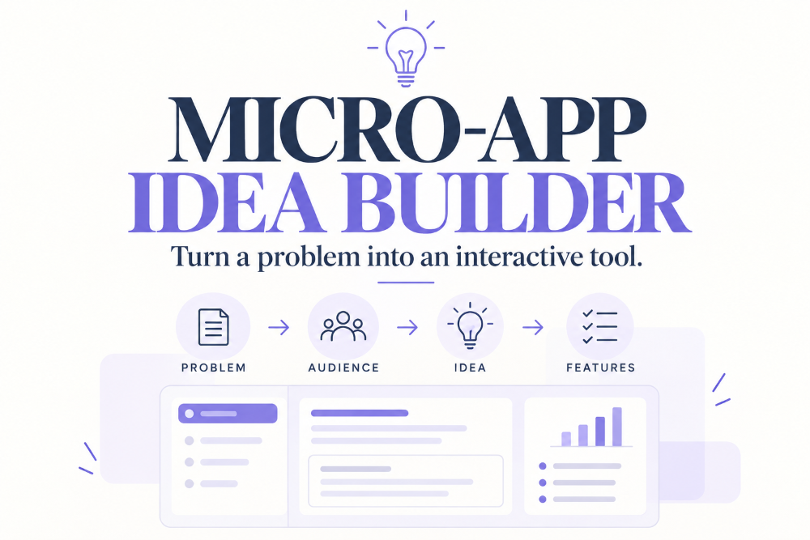

# Micro-App Idea Builder

**Turn a problem into an interactive tool.**

The Micro-App Idea Builder is a free interactive tool that helps you explore ideas for small web applications. Choose an audience, identify a problem and decide what outcome would be useful. The tool generates a micro-app concept, suggested features and practical next steps.

The aim is to help you move from a general idea to a more concrete starting point for building a useful digital tool.

## Try the tool

- **Live demo:** [Micro-App Idea Builder on GitHub Pages](https://todiane.github.io/microapp-idea-builder/)
- **Neocities version:** [Micro-App Idea Builder on Neocities](https://microapp-idea-builder.neocities.org/)

## What can you do with it?

The Idea Finder helps you explore applications that could:

- Help people make decisions.
- Calculate figures or compare scenarios.
- Turn a task into a step-by-step plan.
- Assess a situation and provide personalised feedback.
- Break learning into manageable steps.
- Generate templates, prompts or other useful resources.
- Help people find relevant information.

Based on your selections, the tool suggests an application concept, explains how it could work, lists potential features and outlines the first steps towards building it.

## Features

- Interactive idea generator.
- Audience, problem and outcome selectors.
- Suggested application concepts and features.
- Practical steps for developing a first version.
- Copyable results for use in a project brief.
- Responsive layout for desktop and mobile devices.
- Links to related projects and resources.

## Built with

This is a lightweight, static web application built with:

- **HTML5** for structure.
- **CSS3** for styling and responsive layouts.
- **JavaScript** for interactive behaviour and generating suggestions.

The application runs directly in the browser. It does not require a database, a backend server, an API key or a user account.

Your selections are processed locally in the browser and are not sent to a server by the Idea Finder.

## How to use it

1. Open the live application.
2. Choose the audience you want to help.
3. Select the problem you want to solve.
4. Choose the outcome you want the application to produce.
5. Select **Build my idea**.
6. Review the suggested concept, features and development steps.
7. Copy the result to use as the starting point for your project.

## Free hosting experiment

This project also demonstrates how a self-contained HTML micro-app can be published using free static website hosting.

The same `index.html` application can be deployed to different hosting services without rebuilding the application for each service.

This repository uses GitHub Pages. A separate copy is hosted on Neocities.

The project is part of an exploration of accessible ways to build and publish small interactive web applications.

## More from the developer

I'm **Diane @todianedev**, exploring software development, interactive tools and AI-assisted application building.

- [Djangify](https://www.djangify.com/) – eCommerce builder.
- [Free and premium apps](https://www.dianecorriette.com/shop/) – Explore digital tools and applications.
- [LinkedIn](https://linkedin.com/in/todianedev) – Connect with the developer.
- [Portfolio](https://www.dianecorriette.com/portfolio/) – Explore more projects.

### Want to publish your own AI-built micro-app?

Read the guide: [How to Publish an AI-Built Micro-App for Free](https://www.dianecorriette.com/docs/how-to-publish-an-ai-built-micro-app-for-free/).

## License

No open-source licence has been specified for this repository. Contact the developer before reusing or redistributing the project.
